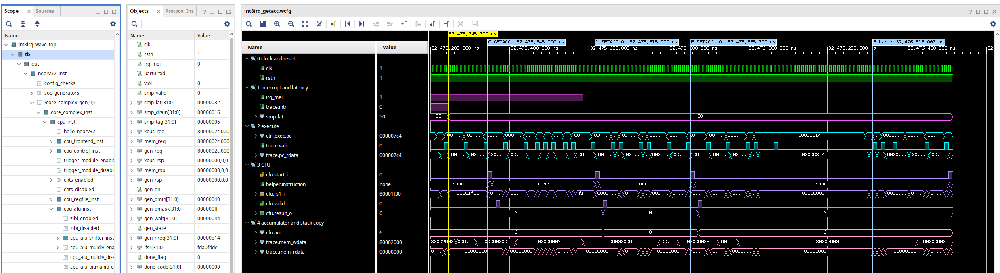
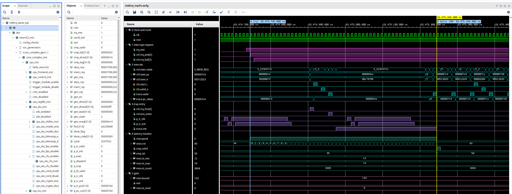
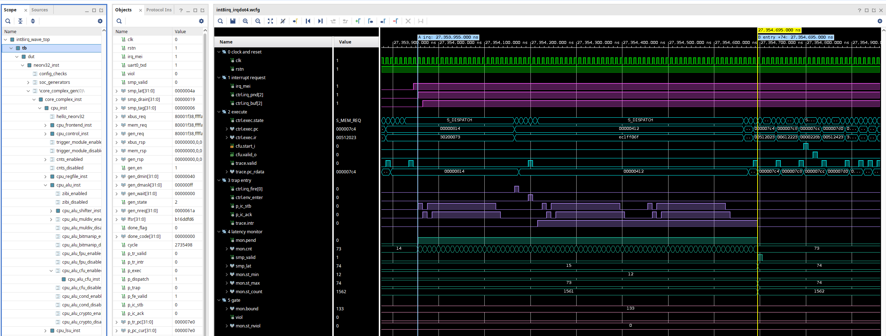
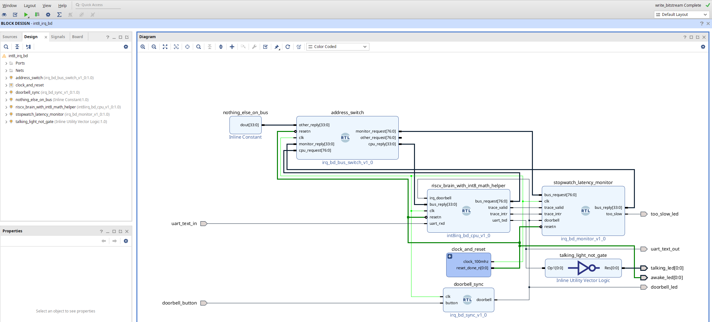
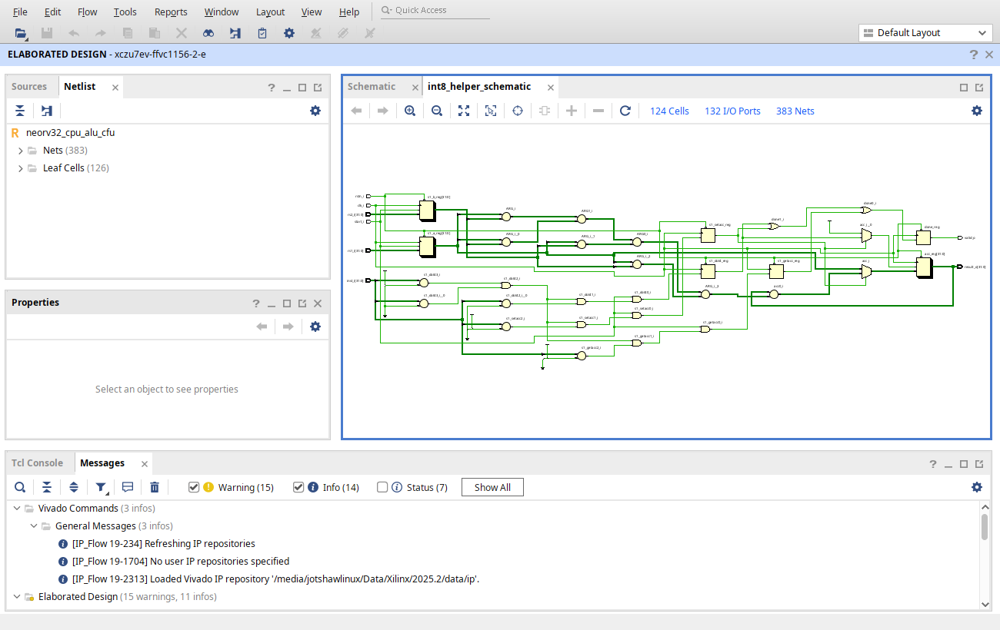
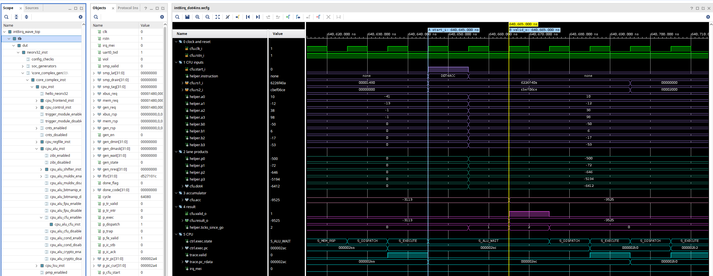

# An INT8 instruction and an interrupt stopwatch on one RISC-V soft CPU

This repo puts two of my earlier NEORV32 projects on one chip:

1. A custom INT8 dot-product instruction (`DOT4ACC`) that runs a small neural network, hls4ml's jet tagger, in 3.3x fewer cycles than plain RISC-V code.
2. A hardware stopwatch that measures, cycle by cycle, how long the CPU takes to answer an interrupt, with a gate that fails the build when an answer is too slow.

Together they answer a third question: what happens to the network and to interrupt response when the CPU does both at once? The answer led to one more instruction, `GETACC`, so an interrupt handler can save and restore the INT8 unit's running total.

Everything here is measured in simulation (Vivado XSim 2025.2, Vitis HLS 2025.2 cosimulation) and in Vivado 2025.2 implementation on the xczu7ev (ZCU104 board part). The run on the ZCU104 board is the next step.

## Result

| | Value |
|---|---|
| Cycles per inference, plain software / with `DOT4ACC` | 118,146 / 35,795 (3.30x) |
| Network outputs bit-exact (64 inputs, 320 values) | 320 of 320 |
| Same, with 19,175 interrupts landing during inference and a handler that uses the INT8 unit | 320 of 320 |
| Worst interrupt response during inference | 74 cycles (average 25.33, limit 133, gate PASS) |
| Same handler without the save | 0 of 320 right, 45 of 64 classes wrong (timing gate still PASS) |
| Cost of the save/restore | `GETACC`: 33 LUTs and 1 flip-flop in the INT8 unit; 4 instructions, 20 cycles per interrupt |
| Block design, 100 MHz, with bitstream | met, WNS +5.543 ns, 3,148 LUTs, 1,919 FFs, 6 BRAM tiles, 4 DSPs |
| hls4ml block of the same INT8 network | identical outputs, 49 cycles per inference, 62,368 LUTs |

## The bug and the fix

The INT8 unit keeps a running total between instructions. A trap does not save it. As long as the interrupt handler leaves the unit alone, every output stays exact. A handler that uses the unit (here a single `SETACC x0, x0`) resets the total in the middle of a sum, and all 320 outputs come out wrong. The interrupt timing gate still passes on that build; only the comparison with the Python golden model catches it.

`GETACC rd` (custom-0, funct7 0, funct3 010) copies the running total into a register and leaves it unchanged. The handler saves it on the stack at entry and puts it back with `SETACC` before `mret`:

```
addi sp, sp, -16      # first handler instruction: the stopwatch stops here
sw   t0, 0(sp)
sw   t1, 4(sp)
GETACC t0             # t0 = running total
sw   t0, 8(sp)
...                   # handler body, free to use DOT4ACC and SETACC
lw   t0, 8(sp)
SETACC x0, t0         # running total = saved value
lw   t0, 0(sp)
lw   t1, 4(sp)
addi sp, sp, 16
mret
```



*Figure 1. The interrupt of figure 2 (markers A and B are there), from the start of the handler (the yellow cursor, B) to the return. `cfu.acc` is 6 when the handler starts: the `DOT4ACC` the CPU completed before answering took it from -21 to 6. `GETACC` copies 6 (C) and it is stored on the stack (`trace.mem_wdata` 00000006). The handler's own `SETACC x0` sets the total to 0 (D). `SETACC t0` puts 6 back (E). The CPU is back in the network at 0x3f2 (F), and the next `DOT4ACC` adds to 6.*

Two other options were measured:
* No new hardware: `DOT4ACC t0, x0, x0` (add zero, return the total) as the read works on the original unit. The run is byte-identical to the `GETACC` run. `GETACC` was kept because it says what it does.
* A second total in hardware (`SELBANK`): 10 cycles per interrupt instead of 20, but it covers one level only (a nested interrupt or a task switch still needs the save), costs 49 LUTs and 36 flip-flops, and takes 0.253 ns of slack at 200 MHz.

## What the INT8 instruction does to interrupt response



*Figure 2. The slowest of the 2,674 interrupts the CPU took at a `DOT4ACC` (the last instruction it completed before the handler): 50 cycles. The request arrives (A) while the CPU is still returning from the previous interrupt (`ctrl.exec.pc` 0x814, `mret`) and waiting for the cache to fetch the code at 0x3ee. NEORV32 takes an interrupt only while an instruction executes (`neorv32_cpu_control.vhd`, `irq_fire`), so the `DOT4ACC` at 0x3ee runs first: `ctrl.irq_fire[0]` goes high as it starts, `cfu.start_i` and `cfu.valid_o` are 2 clock ticks apart, then `ctrl.env_enter`.*

* A `DOT4ACC` takes 5 cycles from one finished instruction to the next. An ordinary ALU instruction takes 2. The CPU never drops an instruction half way, so an interrupt taken at a `DOT4ACC` waits 3 cycles longer.
* That is small next to the instruction cache. The slowest answer during inference, 74 cycles, spent 48 of them with the cache fetching code: 48 words, three 64-byte lines (`sim/logs/count_ic_irqdot4.log`). The cache has 4 lines of 64 bytes; the network code is 440 bytes and the handler competes with it.



*Figure 3. The 74-cycle worst case. The stopwatch runs from marker A (the first clock edge that sees `irq_mei`) to marker B (the first handler instruction completes): 740 ns, 74 ticks of 10 ns. Here, too, the request arrives during the previous interrupt's `mret`, and the cache fetches three 64-byte lines before B.*

## Same network as an hls4ml block

The INT8 network was also built as an hls4ml block for the same part. hls4ml has no requantization layer, so the INT8 arithmetic is written with its Dense and BatchNormalization layers and fixed-point types chosen to match the RISC-V model exactly.

| | Cycles per inference | New input every | LUTs | DSPs | 100 MHz |
|---|---|---|---|---|---|
| RISC-V with `DOT4ACC` (whole system, out of context) | 35,795 | 35,795 cycles | 3,166 | 4 | met, +5.429 ns |
| hls4ml INT8 block, ReuseFactor 4 (out of context) | 49 | 8 cycles | 62,368 | 64 | met, +1.153 ns |

The two give the same 320 outputs, bit for bit (hls4ml RTL cosimulation on the 64 test vectors; the hls4ml C model also matches on 200,005 int8 vectors, 200,000 of them random). The hls4ml block is 730 times faster per inference and 20 times larger in LUTs. Synthesis built most of its 8-bit multiplies in LUTs (64 DSPs placed against 596 in the HLS estimate).

## Other interrupts, other clocks

* Timer, software and fast interrupts: during inference the fastest answer is 12 cycles for each; worst cases 62 (external), 86 (timer, requests landing inside its own handler) and 65 (fast GPIO, 2 cycles of input synchroniser). With the instruction cache off every answer takes 12 to 23 cycles. A second CPU core sharing the instruction bus raises the first core's worst case from 23 to 30 cycles (cache off).
* Static bounds: a worst-case bound built from instruction timings and cache refills, for the earlier handler: 86 cycles for the network scenario, against 82 measured with that handler and 74 with the final one. It is a model with a 2-cycle allowance taken from measurements, not a formal proof.
* Faster clocks: block designs meet timing at 187.5 MHz (the closest the board's PS clock gets to 200) and, with a 3-stage INT8 unit, at 300 MHz (WNS +0.271 ns). The 3-stage unit costs 1,197 cycles per inference and does not have `GETACC` yet.
* Power: Vivado estimates (confidence low, measured before `GETACC` was added) put the INT8 unit at 0.5 to 1.0 mW at 100 MHz; the Zynq PS dominates the 3.37 W total.

## The pieces



*Figure 4. The block design: Zynq PS for the clock, the CPU with the INT8 unit (`DOT4ACC`, `SETACC` and `GETACC` are inside `riscv_brain_with_int8_math_helper`), an address switch, the stopwatch, a push button as the interrupt, LEDs and a UART. It validates, builds to a bitstream and meets 100 MHz with 5.543 ns to spare.*



*Figure 5. The INT8 unit alone: four 8x8 multipliers, an adder tree, the running total and the `GETACC` read path.*



*Figure 6. One `DOT4ACC` inside the full CPU simulation: weights (10, -12, 38, 98) times inputs (-50, 6, -17, -53) add -6,412 to the running total: `cfu.acc` goes from -3,113 to -9,525 when `cfu.valid_o` rises, 2 ticks after `cfu.start_i` (markers A and B).*

The check can fail: with interrupts held off twice as long, one answer takes 905 cycles against a limit of 521, and `viol` goes high and `mon.st_nviol` counts it. `scripts/open_view.sh fail` opens this waveform.

A plain-language guide to every block and every wave row: `docs/how_to_read_the_pictures.md`.

## How it is checked

* The INT8 unit's own testbench: 29,375 instructions from an independent Python model, including 1,264 `GETACC`, 0 errors; two broken copies are caught (23,674 and 5,154 errors).
* The network: every one of 320 outputs compared with a Python INT8 model, alone, with interrupts and a handler that leaves the unit alone, with a handler that uses it and saves the total, and with one that does not save it (all wrong, as expected).
* The stopwatch: the gate script reads the hardware's statistics and every sample, and checks them against limits set from cycle accounting before the run. 39 interrupts were also counted by hand, edge by edge, in the waveforms (15 in this design's earlier runs, 24 in the interrupt-source runs); all agree with the stopwatch.
* A deliberate failure is caught three ways: by the gate script, by the stopwatch's own violation counter and by a testbench assertion.

## Scope and next steps

* Board run: the block design builds to a bitstream. Next is a board version of the program, with the push button as the interrupt and the stopwatch read over the UART, because the simulation program drives the testbench's own test devices.
* Real jets: on the hls4ml jet validation set (Zenodo 3601436, 54,000 test jets) the float Keras model scores 72.84 percent. The INT8 scales here were set on the 64 test vectors; on raw jet features they clip 30.9 percent of the inputs and the INT8 model calls every jet a quark (19.21 percent, the hls4ml INT8 block gives the same). Re-calibrated scales reach 47.99 percent in software; quantization-aware training is the next step.
* `GETACC` in the 3-stage unit, so the 300 MHz build has the save/restore too.
* Power from a simulation of the inference itself (the netlist run so far covered the UART start-up only).

## Reproduce

Requires Vivado 2025.2 (XSim) and a RISC-V GCC (`riscv64-unknown-elf-`). NEORV32 v1.13.6 is a submodule:

```
git clone --recursive https://github.com/taitashaw/neorv32-int8-irq
cd neorv32-int8-irq
scripts/run_unit_getacc.sh                          # INT8 unit testbench: final unit plus two broken copies
scripts/build_dot4_sw.sh dot4_getacc 1 1            # program whose handler uses the INT8 unit and saves the total
scripts/run_sim.sh dot4_getacc sim/images/dot4_getacc/neorv32_imem_image.vhd
python3 scripts/gate.py sim/run_dot4_getacc/xsim.log sim/run_dot4_getacc/irq_samples.csv scripts/bounds_dot4.json
vivado -mode batch -source scripts/build_bd.tcl     # block design and bitstream
```

Expected numbers: `sim/logs/xsim_dot4_getacc.log` (320 of 320 outputs) and `sim/logs/gate_dot4_getacc.txt` (worst 74, average 25.33, bound 133). `scripts/build_dot4_sw.sh dot4_clobber 1 0` builds the handler without the save (all outputs wrong).

To open the pictures on your own screen: `scripts/open_view.sh` (block design, INT8 schematic and the 74-cycle waveform), or `scripts/open_view.sh all` for all seven.

Built on NEORV32 v1.13.6 (BSD-3-Clause) by Stephan Nolting and contributors, and hls4ml.
